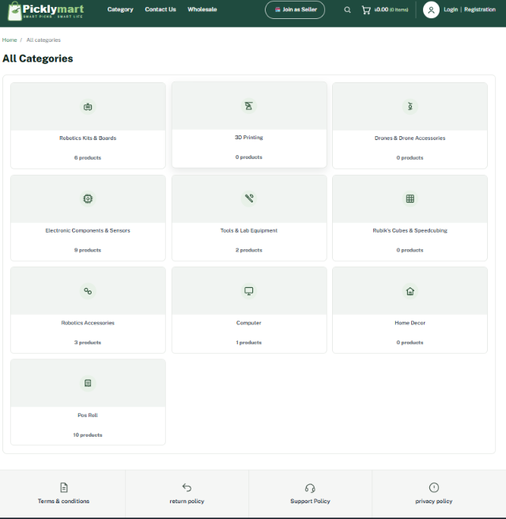
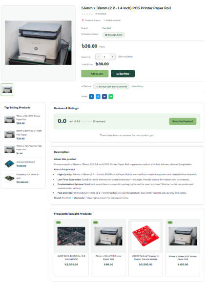
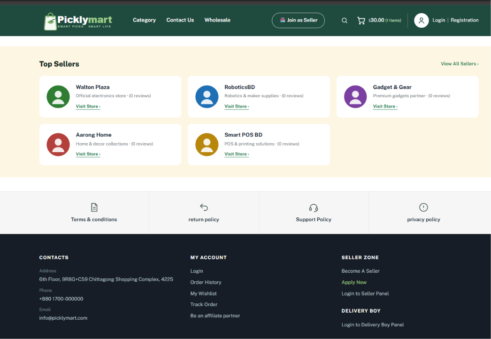
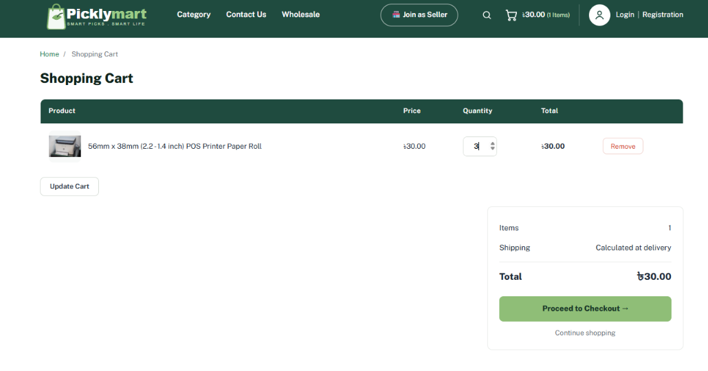
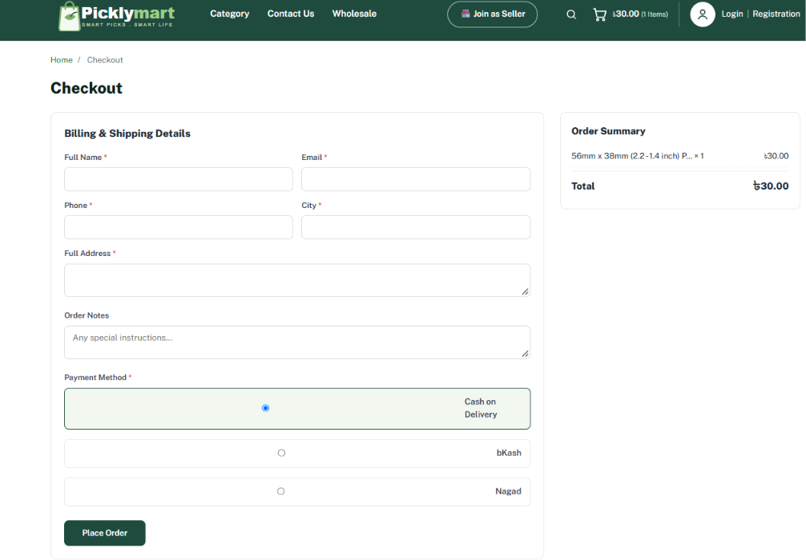
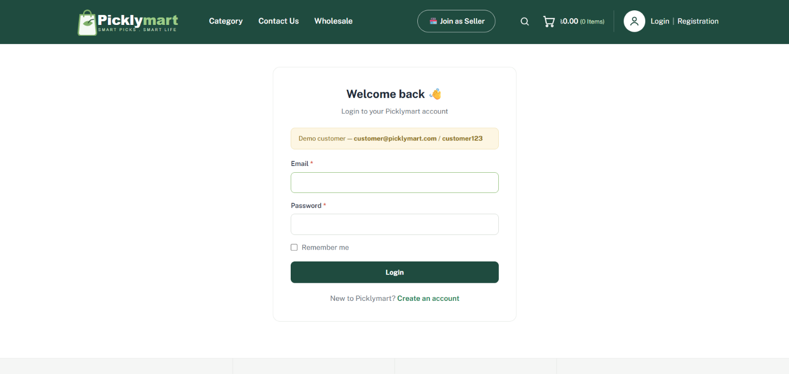
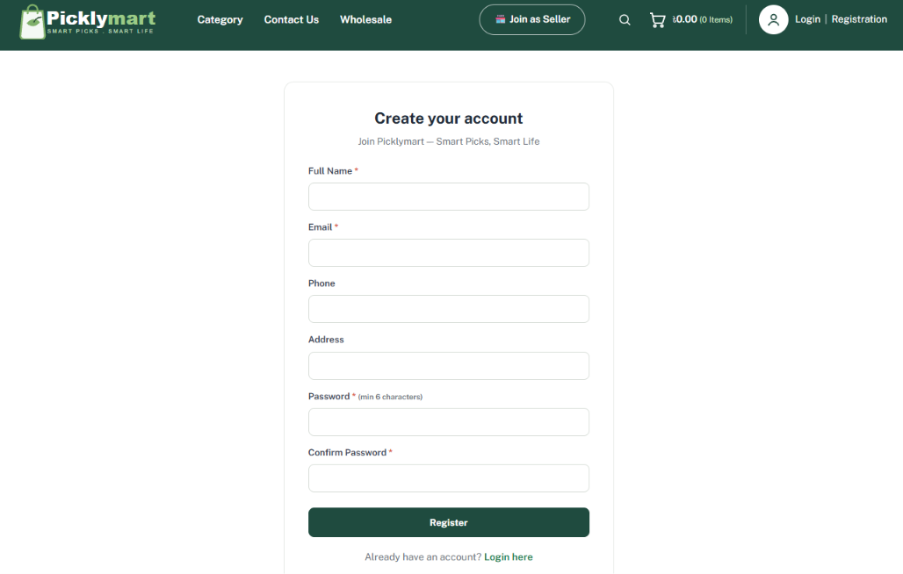
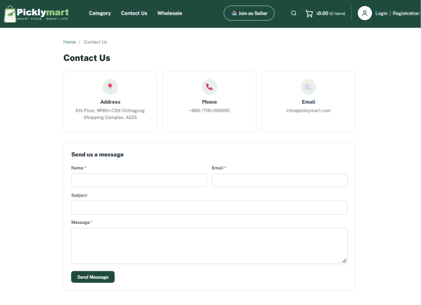
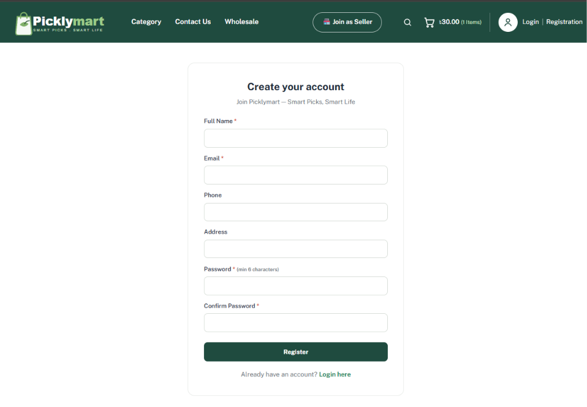

# Picklymart — Laravel Based Ecommerce Website

A Laravel-based ecommerce website inspired by **picklymart.com**.
The project is built with **Laravel 10, PHP, MySQL, HTML, CSS, and JavaScript** and is designed to run easily on **XAMPP**.

## 📸 Website Preview

| Screenshot | Description |
| --- | --- |
|  | The storefront homepage with featured products and shopping sections. |
|  | Browse the store's product categories. |
|  | View product details, images, and purchase options. |
|  | Discover the store's featured sellers. |
|  | Review items and quantities in the shopping cart. |
|  | Enter delivery and payment details to place an order. |
|  | Sign in to an existing customer account. |
|  | Create a new customer account. |
|  | Send a message to the Picklymart team. |
|  | View the page for sellers interested in joining Picklymart. |

---

## ✨ Features

### 🛍️ Customer Storefront
- Responsive homepage with product deals and featured sections.
- Product categories and category-based browsing.
- Product search, sorting, and price-range filtering.
- Product details with image gallery and quantity selector.
- Shopping cart with add, update, and remove functionality.
- Wishlist and product reviews with ratings.
- Checkout with Cash on Delivery, bKash, and Nagad options.
- Order confirmation and customer order history.
- Customer registration and login.
- Contact form and informational pages.
- Wholesale and seller-related pages.
- Bangladeshi Taka (৳) currency formatting.

### 🔐 Admin Dashboard
- Dashboard with statistics and recent orders.
- Create, view, update, and delete products.
- Manage categories and parent-child relationships.
- Configure featured, new, best-selling, and deal products.
- Manage customer orders and update their statuses.
- View and manage contact messages.

### 🎨 User Experience
- Responsive layouts for desktop and mobile devices.
- Consistent ecommerce styling and reusable Blade templates.
- Interactive product galleries, quantity controls, and carousels.
- Session-based shopping cart.

---

## 🛠️ Technologies Used

| Technology | Purpose |
|---|---|
| PHP 8.1+ | Backend programming |
| Laravel 10 | Web application framework |
| MySQL | Relational database |
| Blade | Server-rendered templates |
| HTML5 | Page structure |
| CSS3 | Styling and responsive layouts |
| JavaScript | Frontend interactions |
| Apache / XAMPP | Local development environment |
| Composer | PHP dependency management |

---

## 📋 Requirements

Install the following before running the project:

- [XAMPP](https://www.apachefriends.org/) with PHP 8.1 or higher
- [Composer 2.x](https://getcomposer.org/download/)
- A modern web browser

Apache and MySQL should be available through the XAMPP Control Panel.

---

## 🚀 Installation Guide

Follow these steps to run Picklymart on Windows using XAMPP.

### 1. Clone the repository

Open PowerShell or the VS Code terminal:

```powershell
cd C:\xampp\htdocs
git clone https://github.com/Tahmid1083/picklymart-laravel.git
cd picklymart-laravel
```

Alternatively, download the repository as a ZIP file and extract it into `C:\xampp\htdocs`.

### 2. Start XAMPP

Open the XAMPP Control Panel and start:

- Apache
- MySQL

### 3. Create the database

1. Open [phpMyAdmin](http://localhost/phpmyadmin).
2. Click **New**.
3. Create a database named `picklymart`.
4. Select the `utf8mb4_unicode_ci` collation if available.

### 4. Install dependencies

Run this command from the project directory:

```bash
composer install
```

### 5. Configure the environment

Create your local `.env` file from the example:

```powershell
Copy-Item .env.example .env
```

If `.env.example` does not exist, create one using the required settings from the project's Laravel configuration.

Configure your local database connection in `.env`:

```env
APP_NAME=Picklymart
APP_ENV=local
APP_DEBUG=true
APP_URL=http://localhost/picklymart-laravel/public

DB_CONNECTION=mysql
DB_HOST=127.0.0.1
DB_PORT=3306
DB_DATABASE=picklymart
DB_USERNAME=root
DB_PASSWORD=
```

These database credentials assume a default local XAMPP installation. Use your own database credentials if they differ.

Generate an application key:

```bash
php artisan key:generate
```

### 6. Run database migrations and seeders

```bash
php artisan migrate --seed
```

This creates the database tables and inserts demo data configured by the project's seeders, such as sample products, categories, and accounts.

### 7. Start the website

**Option A — XAMPP**

Open:

[http://localhost/picklymart-laravel/public](http://localhost/picklymart-laravel/public)

**Option B — Laravel development server**

Run:

```bash
php artisan serve
```

Then visit:

[http://127.0.0.1:8000](http://127.0.0.1:8000)

If Laravel reports a storage or cache permission error, make sure `storage/` and `bootstrap/cache/` are writable.

---

## 🔑 Demo Accounts

The following credentials are available only if the corresponding demo accounts are configured by the project's seeders.

| Role | Email | Password |
|---|---|---|
| Customer | `customer@picklymart.com` | `customer123` |

---

## 📁 Project Structure

```text
picklymart-laravel/
├── app/
│   ├── Http/Controllers/    # Application controllers
│   ├── Models/              # Eloquent models
│   └── Services/             # Business logic and cart service
├── bootstrap/                # Laravel bootstrap files
├── config/                   # Application configuration
├── database/
│   ├── migrations/           # Database schema
│   └── seeders/              # Demo data
├── public/
│   ├── css/                  # Stylesheets
│   ├── js/                   # JavaScript
│   └── images/               # Website images and assets
├── resources/
│   └── views/                # Blade templates
├── routes/
│   └── web.php               # Web routes
├── Screenshots/              # README preview images
├── .env.example              # Example environment configuration
├── .gitignore
├── artisan
├── composer.json
├── composer.lock
└── README.md
```

---

## 🛠️ Troubleshooting

### `could not find driver`

1. Open `C:\xampp\php\php.ini`.
2. Find `;extension=pdo_mysql`.
3. Remove the leading semicolon if the extension is disabled.
4. Restart Apache and try again.

### Composer reports a PHP version error

Check the PHP version used by your terminal:

```bash
php -v
```

Make sure Composer uses a compatible PHP installation.

### Laravel returns a 404 error

For XAMPP, verify that the URL includes `/public`:

```text
http://localhost/picklymart-laravel/public
```

### Database connection error

- Make sure MySQL is running.
- Verify the database name and credentials in `.env`.
- Confirm that the `picklymart` database exists.

### Reset the demo database

```bash
php artisan migrate:fresh --seed
```

**Warning:** This command drops existing tables and data before recreating them. Do not use it on a database containing data you need to keep.

---

## 🔒 Security Notes

- Never commit `.env`, passwords, API keys, or other secrets.
- Keep `.env.example` free of real credentials.
- Use `APP_DEBUG=false` and secure production configuration when deploying.
- The demo account credentials are for local development only; change them before any public deployment.
- Payment options are presented as demonstration functionality unless real payment gateway integration has been implemented and configured.

---

## 📌 Project Notes

- Created for learning and educational purposes.
- Inspired by the publicly accessible Picklymart storefront.
- Uses Laravel Blade, Eloquent ORM, and session-based cart functionality.
- Does not require a Node.js or npm build step.
- Actual functionality depends on the implementation and configuration in the source code.

## 👨‍💻 Author

**Tahmid Jamal**

- GitHub: [@Tahmid1083](https://github.com/Tahmid1083)
- Project Repository: [picklymart-laravel](https://github.com/Tahmid1083/picklymart-laravel)

---

<p align="center">
  <b>Built with Laravel and PHP ❤️</b>
</p>
