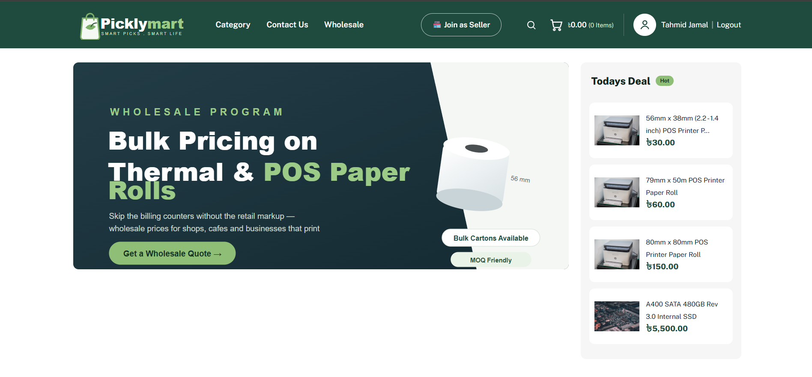

# Picklymart — Laravel Ecommerce Clone

A Laravel-based ecommerce website inspired by **picklymart.com**.
The project is built with **Laravel 10, PHP, MySQL, HTML, CSS, and JavaScript** and is designed to run easily on **XAMPP**.

## 📸 Website Preview

<p align="center">
  
</p>
---

## ✨ Features

### 🛍️ Customer / Storefront

* Responsive ecommerce homepage
* Product categories and category pages
* Product search
* Product sorting and price filtering
* Product details with image gallery
* Product quantity selector
* Shopping cart
* Wishlist
* Product reviews and ratings
* Checkout system
* Cash on Delivery, bKash and Nagad payment options
* Order confirmation
* Customer registration and login
* Customer order history
* Contact form
* Wholesale page
* Terms, Return, Support and Privacy pages
* BDT (৳) currency support


## 🛠️ Technologies Used

| Technology | Purpose                  |
| ---------- | ------------------------ |
| Laravel 10 | Backend framework        |
| PHP 8.1+   | Server-side programming  |
| MySQL      | Database                 |
| Blade      | Frontend templates       |
| HTML5      | Page structure           |
| CSS3       | Styling                  |
| JavaScript | Frontend interactions    |
| XAMPP      | Local development server |

---

## 📋 Requirements

Before installing the project, make sure you have:

* XAMPP with PHP **8.1 or higher**
* Apache
* MySQL
* Composer 2.x
* Web browser

Composer can be downloaded from:

https://getcomposer.org/download/

---

# 🚀 Installation

## 1. Copy the project

Copy the project folder into the XAMPP `htdocs` directory:

```text
C:\xampp\htdocs\picklymart-laravel
```

---

## 2. Start XAMPP

Open the XAMPP Control Panel and start:

* Apache
* MySQL

---

## 3. Create the database

Open phpMyAdmin:

```text
http://localhost/phpmyadmin
```

Create a new database named:

```text
picklymart
```

Recommended collation:

```text
utf8mb4_unicode_ci
```

---

## 4. Install Laravel dependencies

Open Command Prompt inside the project folder:

```bash
cd C:\xampp\htdocs\picklymart-laravel
```

Then run:

```bash
composer install
```

---

## 5. Configure the environment

The project includes a `.env` file configured for XAMPP.

The database settings should be:

```env
DB_DATABASE=picklymart
DB_USERNAME=root
DB_PASSWORD=
```

If you need to generate a new application key:

```bash
php artisan key:generate
```

---

## 6. Create database tables and demo data

Run:

```bash
php artisan migrate --seed
```

This will create the database tables and insert the demo data.

The seed data includes:

* Categories
* Products
* Sellers
* Admin account
* Demo customer account

---

# 🌐 Running the Website

### Option 1 — XAMPP

Open:

```text
http://localhost/picklymart-laravel/public
```

### Option 2 — Laravel Development Server

From the project folder, run:

```bash
php artisan serve
```

Then open:

```text
http://127.0.0.1:8000
```

---

# 🔑 Demo Accounts

### Customer

```text
Email: customer@picklymart.com
Password: customer123
```

New customers can also register from the website.

---

# 📁 Project Structure

```text
picklymart-laravel/
│
├── app/
│   ├── Http/Controllers/
│   ├── Models/
│   └── Services/
│
├── database/
│   ├── migrations/
│   └── seeders/
│
├── resources/
│   └── views/
│       ├── layouts/
│       ├── partials/
│       ├── home/
│       ├── products/
│       ├── category/
│       ├── cart/
│       ├── checkout/
│       ├── auth/
│       ├── pages/
│
├── public/
│   ├── css/
│   ├── js/
│   └── images/
│
├── routes/
│   └── web.php
│
├── .env
└── composer.json
```

---

# 🛠️ Common Problems

### `could not find driver`

Open:

```text
C:\xampp\php\php.ini
```

Make sure this extension is enabled:

```ini
extension=pdo_mysql
```

Restart Apache after making the change.

---

### Laravel 404 error

If you are using XAMPP, make sure you include the `public` directory:

```text
http://localhost/picklymart-laravel/public
```

---

### Composer PHP version error

Check your PHP version:

```bash
php -v
```

Laravel 10 requires PHP 8.1 or higher.

---

### Reset the database

To remove the existing tables and recreate the demo data:

```bash
php artisan migrate:fresh --seed
```

**Warning:** This deletes the existing database tables and data.

---

## 📌 Important Notes

* This project is intended for **learning and educational purposes**.
* The design and product information are inspired by the public Picklymart storefront.
* It uses Laravel Blade, Eloquent ORM and session-based cart functionality.
* No frontend build process is required.
* Payment methods such as bKash and Nagad are included as checkout options for demonstration purposes.

---

## 👨‍💻 Author

**Tahmid Jamal**

GitHub: `Tahmid1083`
